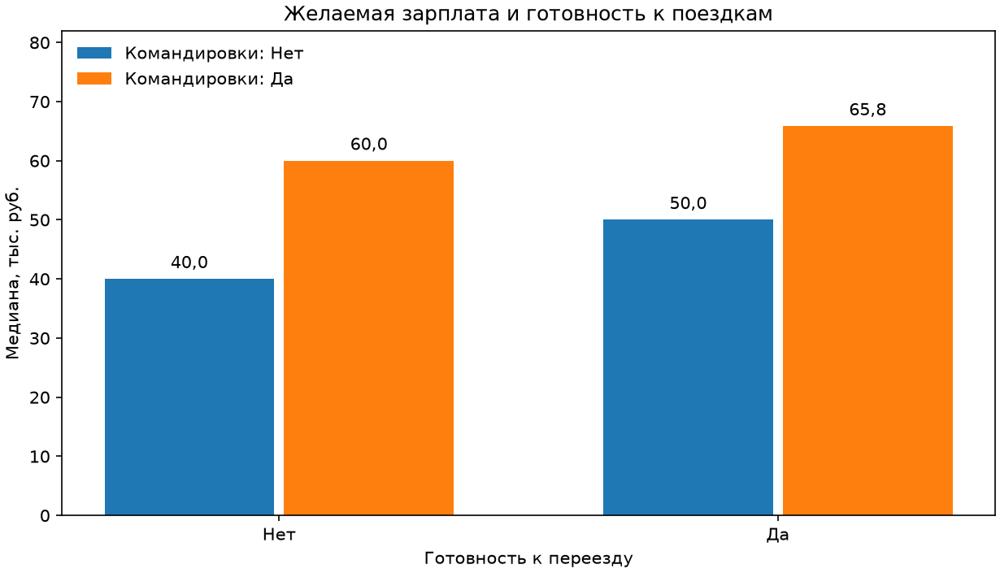
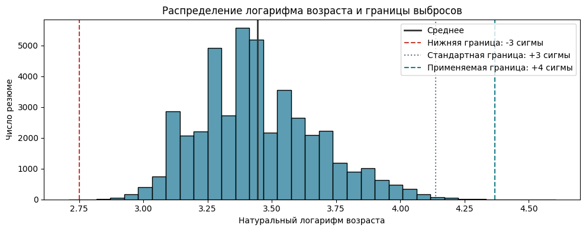

# Анализ резюме HeadHunter

Учебный проект SkillFactory по Python для анализа данных. Взял резюме с HeadHunter, привёл зарплаты к рублям и посмотрел, как различаются ожидания соискателей.

[Открыть блокнот с кодом и выводами](<Python_для_анализа_данных__Итоговыи__проект.ipynb>)

## Данные

- [Резюме HeadHunter](https://drive.google.com/file/d/1Kb78mAWYKcYlellTGhIjPI-bCcKbGuTn/view). Исходная таблица содержит 44 744 строки и 12 столбцов.
- [Архив исторических курсов валют](https://lms-cdn.skillfactory.ru/assets/courseware/v1/15abf80f45a2f3e93c3274101b451c67/asset-v1:skillfactory+MIFIML-1sem+2026+type@asset+block/ExchangeRates.zip). По нему зарплатные ожидания приведены к рублям на дату обновления резюме.

Блокнот загружает оба источника по ссылкам. Для полного запуска нужен интернет.

В публичном блокноте я убрал сохранённые примеры строк из задания 2.2 и таблицу описательной статистики из задания 2.5. В них были исходные значения из резюме, в том числе даты рождения. Код ячеек, итоговые подсчёты и выводы оставил.

## Этапы работы

1. Проверил структуру таблицы, типы данных и пропуски.
2. Выделил возраст, пол, образование и стаж. Разобрал предпочтения по занятости, графику и переезду. Перевёл зарплаты в рубли.
3. Сравнил зарплатные ожидания по группам и проверил связь возраста со стажем.
4. Удалил дубликаты, обработал пропуски и проверил выбросы.

## Результаты

После очистки осталось **44 482 строки и 23 столбца**. Пропусков нет.

- Среди резюме с ожиданиями ниже 1 млн руб. медиана в Москве составила 85 тыс. руб. В группе «другие» она равна 40 тыс. руб., хотя именно там встретилась самая высокая сумма в этой выборке.
- Ожидания заметнее различались по готовности к командировкам, чем по готовности к переезду. Среди тех, кто не готов переезжать, разница между медианами по готовности к командировкам составила 20 тыс. руб.
- В семи резюме заявленный стаж превышал возраст. У двух из них разница составила всего 2 и 3 месяца, поэтому на общем графике точки почти сливаются с диагональю.

Эти сравнения описывают желаемые зарплаты из резюме. Состав групп по профессиям и опыту может различаться.

## Графики





Интерактивные графики лежат в папке [plots](plots/). Чтобы наводить указатель на точки и менять масштаб, скачайте нужный HTML-файл и откройте его в браузере с доступом в интернет.

| Что посмотреть | HTML |
|---|---|
| Распределения | [Возраст](plots/01-age.html), [стаж](plots/02-experience.html), [зарплата](plots/03-salary-distribution.html), [зарплата выше миллиона](plots/04-salary-above-million.html) |
| Сравнение зарплат | [Образование](plots/05-education.html), [город](plots/06-city.html), [готовность к переезду и командировкам](plots/07-mobility.html), [возраст и образование](plots/08-age-and-education.html) |
| Возраст и стаж | [Диаграмма рассеяния](plots/09-age-and-experience.html), [стаж выше возраста](plots/10-experience-outliers.html) |
| Дополнительный анализ | [Удалённая работа](plots/11-remote-work-and-gender.html), [командировки](plots/12-business-travel-and-gender.html) |

## Как запустить

Используйте Python 3.12. В папке проекта выполните:

```bash
python3 -m venv .venv
source .venv/bin/activate
python -m pip install -r requirements.txt
```

Откройте блокнот в VS Code, выберите Python из `.venv` как ядро и выполните все ячейки по порядку.
